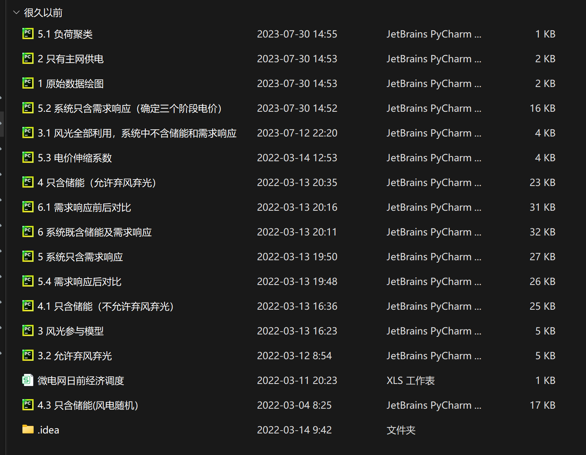
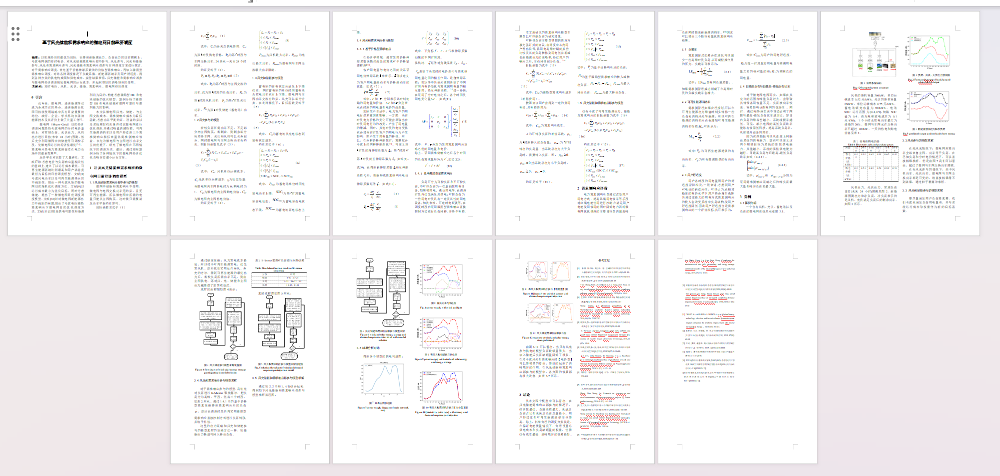
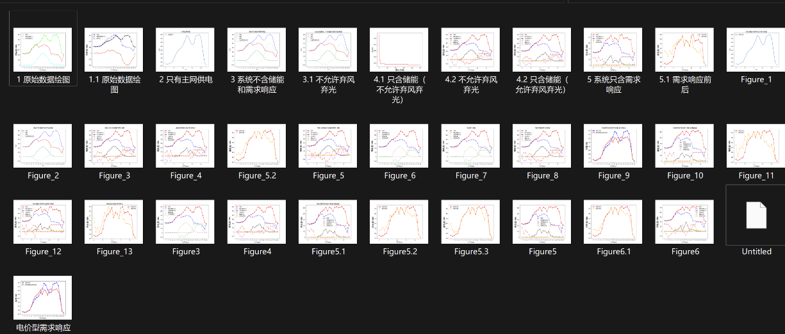
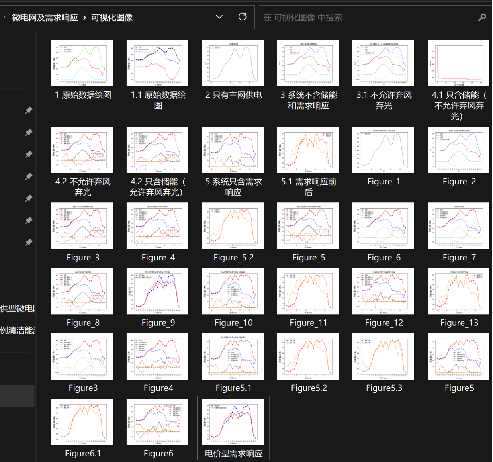

# Economic dispatch of wind-solar energy storage microgrid considering demand response based on particle swarm optimization algorithm (Python code implementation)

Particle Swarm Optimization Algorithm-Based Economical Dispatch of Wind and Solar Energy Storage Microgrid Considering Demand Response (Python Code Implementation)

Code Overview:
\n        \n      \n        \n      Operational Results:
\n        \n      \n        \n

## Images

<!-- PAYMENT_BLOCK -->

## Get this dataset

- Payment link (Stripe): [Buy now](https://buy.stripe.com/3cs8yP7sY87d0vu9AB)
- Payment QR code: 

<!-- /PAYMENT_BLOCK -->
